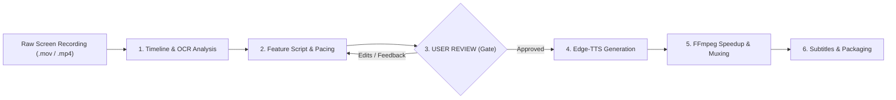

# AI Voiceover Demo Video Production

This skill provides an automated, end-to-end procedure for turning raw screen recordings into professional, high-tempo, voiceovered product demo videos with synchronized subtitles.

---

## Workflow Overview



---

## Quick Start (Automated Scripts)

Helper scripts are available in [`scripts/`](./scripts/):

1. **Analyze Recording**:
   ```bash
   python3 scripts/analyze_video.py <input.mov> --output-json timeline.json
   ```
2. **Draft Script & Submit for User Review**:
   Present the draft script table and timing to the user for approval.
3. **Generate Voiceover (After User Approval)**:
   ```bash
   python3 scripts/generate_voiceover.py script.json --voice en-US-JennyNeural --rate +20%
   ```
4. **Assemble Synchronized Demo Video**:
   ```bash
   python3 scripts/assemble_demo.py <input.mov> audio/metadata.json --output demo_final.mp4
   ```

---

## Step-by-Step Procedure

### 1. Inspect Prerequisites & Video Stream
Verify required tools:
```bash
which ffmpeg ffprobe
which edge-tts || ~/.local/bin/uvx edge-tts --help
```
Inspect recording duration and resolution:
```bash
ffprobe -v error -show_entries format=duration -show_entries stream=width,height,codec_name -of json input.mov
```

### 2. Visual Content & Timeline Extraction
Sample thumbnail frames every 2 to 3 seconds:
```bash
mkdir -p .frames && ffmpeg -y -i input.mov -vf "fps=1/3,scale=960:-1" .frames/f_%03d.jpg
```
Use macOS Vision OCR (via `scripts/analyze_video.py`) or inspect key frames to identify:
- Application switches, tab changes, and UI panel activations.
- Exact start and end timestamps for each feature shown.
- Long pauses, cursor hesitations, or typing delays suitable for acceleration.

### 3. Voiceover Script & Timing Budget
Calculate the time budget:
- If target duration is $\le 90$s, aim for **75–85 seconds** total.
- At an accelerated demo pace (`+20%` to `+25%`), speaking rate is ~3.0 words/second.
- Draft 1 concise, punchy sentence per feature (20–35 words per segment).

Map each feature to:
```json
[
  {
    "id": "01_feature_name",
    "feature": "Feature Title",
    "original_timerange": [start_sec, end_sec],
    "text": "Script explaining what is happening on screen and its value."
  }
]
```

### 4. Mandatory User Review Gate (Before Audio Generation)
> [!IMPORTANT]
> **DO NOT proceed to audio generation or video rendering without explicit user review and confirmation.**

Always present the drafted script table to the user:
1. **Feature Breakdown**: Table showing segment index, feature name, video clip timestamps, estimated target duration, and proposed narration text.
2. **Voice & Pacing Parameters**: Mention selected voice (e.g., `en-US-JennyNeural`, `en-US-AriaNeural`, `en-US-GuyNeural`) and speaking rate (e.g. `+20%`).
3. **Ask for User Feedback**:
   > *"Please review the proposed voiceover transcript and timeline above. Would you like to make any adjustments to the wording, tone, or pacing before I proceed with generating the audio and assembling the video?"*
4. Incorporate any edits requested by the user. Only proceed to Step 5 once the user approves.

### 5. Edge-TTS Audio Generation
Generate voice segments:
```bash
uvx edge-tts --voice en-US-JennyNeural --rate +24% --text "<sentence>" --write-media audio/<id>.mp3
```
Probe each clip's duration with `ffprobe`:
```bash
ffprobe -v error -show_entries format=duration -of default=noprint_wrappers=1:nokey=1 audio/<id>.mp3
```

Refer to [`references/edge_tts_voices.md`](./references/edge_tts_voices.md) for recommended voices:
- Clear female: `en-US-JennyNeural`, `en-US-AriaNeural`, `en-US-EmmaMultilingualNeural`
- Authoritative male: `en-US-GuyNeural`, `en-US-ChristopherNeural`

### 6. Synchronized Video Speedup & Assembly
For each segment $i$:
$$\text{Speedup Factor } S_i = \frac{\text{original\_timerange\_duration}}{\text{audio\_duration}}$$

Render the sped-up clip with resampled 48kHz audio:
```bash
ffmpeg -y -ss <start> -to <end> -i input.mov -i audio/<id>.mp3 \
  -filter_complex "[0:v]setpts=PTS/<speed>,scale=1920:1242,fps=30[v];[1:a]aformat=sample_rates=48000:channel_layouts=stereo[a]" \
  -map "[v]" -map "[a]" -c:v libx264 -preset fast -crf 18 -c:a aac -b:a 192k -shortest clip.mp4
```

Concatenate clips:
```bash
ffmpeg -y -f concat -safe 0 -i concat.txt -c:v copy -c:a aac -b:a 192k output_clean.mp4
```

### 7. Subtitles & Deliverable Packaging
1. Generate `.srt` subtitles using cumulative timestamps.
2. Embed soft subtitles in MP4:
   ```bash
   ffmpeg -y -i output_clean.mp4 -i output.srt -c copy -c:s mov_text -metadata:s:s:0 language=eng final_demo.mp4
   ```
3. Save artifacts in project subfolder (e.g. `<project>/artifacts/`):
   - `TRANSCRIPT.md`: Full text, speaker timing, and pointers.
   - `DEMO_REPORT.md`: Production specs, speed calculations, and feature summary.
   - Subtitle file (`.srt`).
